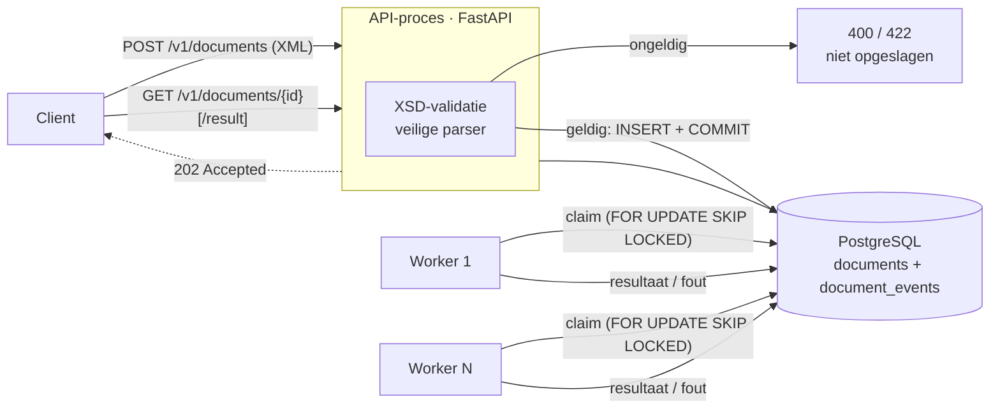
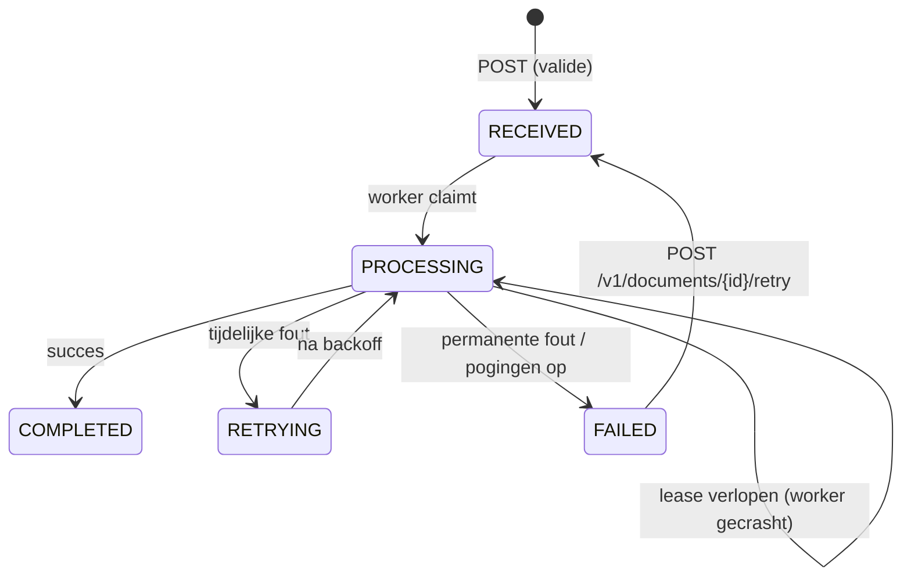

# XML Document Processor

Een minimale back-end die XML-bestellingen ontvangt via een REST API, valideert tegen een XSD en asynchroon verwerkt tot JSON. Documenten gaan niet verloren: een document is pas geaccepteerd (`202 Accepted`) nadat het duurzaam in de database staat. De status van elk document is op elk moment op te vragen, inclusief de volledige historie.

**Stack:** Python 3.12 · FastAPI · SQLAlchemy 2 · PostgreSQL (SQLite voor lokaal/tests) · lxml · Docker · GitHub Actions

---

## Snel starten

### Met Docker (aanbevolen)

```bash
make up      # PostgreSQL + migraties + API + worker (docker compose up -d --build --wait)
make demo    # loopt de hele flow door (vereist curl en jq)
make         # overzicht van alle commando's
```

- **Swagger UI:** <http://localhost:8000/docs>.
  1. Klik *Authorize* (API-key: `dev-key`).
  2. Kopieer de voorbeeldbestelling uit de beschrijving van `POST /v1/documents` en plak die onder *Try it out*. Swagger-UI kan een letterlijk XML-voorbeeld niet zelf invullen.
- **Redoc:** <http://localhost:8000/redoc> toont hetzelfde voorbeeld als request sample, met een kopieerknop.
- Meerdere workers: `docker compose up -d --scale worker=3`
- Retries zien: `SIMULATED_FAILURE_RATE=0.5 docker compose up -d` en volg `docker compose logs -f worker`

### Zonder Docker

```bash
make install                                            # dependencies + git pre-commit hooks
cp .env.example .env
uv run alembic upgrade head                             # schema aanmaken/bijwerken
uv run uvicorn --factory app.main:create_app --reload   # terminal 1: API
uv run python -m app.worker                             # terminal 2: worker
```

### Tests

```bash
make check                                                  # lint, mypy, tests + coverage, pip-audit
make e2e                                                    # end-to-end tegen draaiende stack
TEST_DATABASE_URL=postgresql+psycopg://... uv run pytest    # dezelfde tests op PostgreSQL
```

### Voorbeeld

```bash
curl -X POST http://localhost:8000/v1/documents \
  -H "X-API-Key: dev-key" -H "Content-Type: application/xml" \
  -H "Idempotency-Key: ORD-2026-0001" \
  --data-binary @samples/valid_order.xml
# → 202 {"id": "…", "status": "RECEIVED", "links": {...}}
# Hetzelfde verzoek nog eens → 200 met hetzelfde id (header Idempotent-Replayed: true)

curl -H "X-API-Key: dev-key" http://localhost:8000/v1/documents/<id>          # status + historie
curl -H "X-API-Key: dev-key" http://localhost:8000/v1/documents/<id>/result   # JSON-resultaat
```

---

## Architectuur



**Componenten**

| Onderdeel | Bestand | Verantwoordelijkheid |
|---|---|---|
| API | [app/api.py](app/api.py), [app/main.py](app/main.py) | Ontvangen, valideren, opslaan, status/resultaat tonen |
| Validatie | [app/validation.py](app/validation.py), [app/xsd/order.xsd](app/xsd/order.xsd) | Veilig parsen (XXE-bescherming) en XSD-validatie |
| Queue/opslag | [app/repository.py](app/repository.py), [app/models.py](app/models.py) | Statusovergangen, claimen met lease, historie |
| Worker | [app/worker.py](app/worker.py) | Ophalen, verwerken, retry met backoff, crash-herstel |
| Verwerking | [app/processing.py](app/processing.py) | XML → JSON, totalen berekenen, businessregel controleren |
| Auth / logging | [app/auth.py](app/auth.py), [app/logging_config.py](app/logging_config.py) | API-key, JSON-logs met correlatie-ID's |
| Migraties | [migrations/](migrations/) | Databaseschema in versies (Alembic), als aparte stap vóór de API en de worker |

**Statusmodel**



Elke overgang wordt vastgelegd in `document_events`, zichtbaar via `GET /v1/documents/{id}`.

**API**

| Methode | Pad | Beschrijving |
|---|---|---|
| `POST` | `/v1/documents` | XML aanleveren → `202` (+ `Location`). Met een bekende `Idempotency-Key`: `200` en het bestaande document. Fouten: `400` niet well-formed, `422` schemafout of key hergebruikt voor een ander document, `413` te groot, `415` verkeerd Content-Type |
| `GET` | `/v1/documents?status=&limit=&offset=` | Overzicht, optioneel gefilterd op status |
| `GET` | `/v1/documents/{id}` | Status, aantal pogingen, laatste fout en historie |
| `GET` | `/v1/documents/{id}/result` | JSON-resultaat (`409` zolang niet `COMPLETED`) |
| `POST` | `/v1/documents/{id}/retry` | `FAILED` document opnieuw in de queue (`409` bij een gelijktijdige wijziging) |
| `GET` | `/health` | Liveness + databasecheck (zonder authenticatie) |

De documentpaden hebben een **versie** (`/v1`). Een wijziging die bestaande clients zou breken, komt onder `/v2` naast de huidige versie, zodat aanleverende partijen in hun eigen tempo kunnen overstappen. `/health` is voor de infrastructuur (load balancer, Docker) en geen onderdeel van dat contract, dus zonder versie.

---

## Keuzes en afwegingen

### 1. De database als queue, geen message broker

De belangrijkste eis: **een geaccepteerd document mag nooit verloren gaan.** Voor de status is sowieso een database nodig. De vraag is dus of het werk via die database loopt, of via een aparte broker (RabbitMQ, SQS, Kafka).

**Het probleem met een broker.** De API moet dan in twee systemen schrijven, en dat kan niet atomair (het *dual-write*-probleem):

| Volgorde | Wat er mis kan gaan | Gevolg |
|---|---|---|
| Eerst DB-commit, dan publish | Publish faalt (broker plat, crash ertussen) | Document blijft eeuwig `RECEIVED`: **stil verlies** |
| Eerst publish, dan DB-commit | Commit faalt | Worker krijgt een bericht voor een document dat niet bestaat |

De standaardoplossing is een *transactional outbox*: het bericht gaat in dezelfde transactie naar een database-tabel, en een relay publiceert het. Die outbox is zelf al een database-queue. Een broker zou hem dus niet vervangen, maar er een laag bovenop zetten.

- **Hier is het één commit:** opslaan is tegelijk in de wachtrij zetten. Pas daarna volgt `202`. Status, pogingen en fouten staan op één plek en zijn met SQL op te vragen. Er is geen extra infrastructuur nodig.
- **Afgevallen: FastAPI `BackgroundTasks`.** Dat voert de verwerking uit na het versturen van het antwoord, in hetzelfde API-proces en alleen in het geheugen. Herstart of crasht de API voordat de taak klaar is, dan is die taak weg, terwijl de client al een `202` heeft gekregen.
- **De prijs:** polling-latency (standaard 1 s) en een lagere doorvoer dan een broker. Bij het aangenomen volume (zie [Aannames](#aannames)) en één type consumer weegt correctheid zwaarder.

### 2. Claimen, leases en at-least-once

- **Claimen** gebeurt met `SELECT … FOR UPDATE SKIP LOCKED`. Meerdere workers pakken zo tegelijk werk op zonder elkaar te blokkeren of hetzelfde document te kiezen.
- **Lease** (`locked_until`): crasht een worker tijdens de verwerking, dan verloopt de lease en pakt een andere worker het document op. Niets blijft hangen.
- **Optimistic locking** (`version`-kolom): een worker wiens lease is overgenomen kan zijn verouderde resultaat niet meer wegschrijven. Op SQLite (geen `SKIP LOCKED`) garandeert dit ook dat een claim maar één keer slaagt.
- **De verwerking draait buiten een transactie.** Er worden geen database-locks vastgehouden terwijl een (mogelijk trage) verwerking loopt.
- Het gevolg is *at-least-once*: in een uitzonderlijk geval wordt een document twee keer verwerkt. Daarom is de verwerking een pure, idempotente functie.
- **Healthcheck voor de worker.** De worker heeft geen HTTP-poort. Hij raakt daarom bij elke loop-iteratie een heartbeat-bestand aan, en de healthcheck kijkt naar de leeftijd van dat bestand. Een loop die binnen één lease niet terugkomt, zit vast.
  - Dit is een *liveness*-check, geen *readiness*-check. Ligt de database plat, dan blijft de worker gezond: een herstart lost dat niet op, en de loop herstelt zelf.
- De versiecheck geldt ook in de API. Twee gelijktijdige retry-verzoeken op hetzelfde document geven `409 Conflict` en geen `500`.

### 3. Idempotente inzending (`Idempotency-Key`)

"Niets mag verloren gaan" betekent in de praktijk dat clients bij twijfel opnieuw insturen, bijvoorbeeld na een timeout terwijl de commit al gelukt was. Zonder maatregel ontstaat dan een duplicaat.

- **Optionele header:** de client kan een `Idempotency-Key` meesturen (volgens de IETF-draft *The Idempotency-Key HTTP Header Field*).
- **Herhaling met dezelfde inhoud:** een tweede verzoek met dezelfde key en dezelfde inhoud geeft `200` met het bestaande document en de actuele status, plus de header `Idempotent-Replayed: true`. De eerste keer is het `202`.
- **Zelfde key, andere inhoud:** de inhoud wordt vergeleken via een SHA-256-hash. Een andere inhoud met dezelfde key is een clientfout en geeft `422`. Het oude document stil teruggeven zou verbergen dat het nieuwe nooit is geaccepteerd.
- **Gelijktijdige verzoeken:** komen twee verzoeken met dezelfde key tegelijk binnen, dan beslist een **unique constraint** in de database. Het verliezende verzoek krijgt het antwoord van het winnende.
- **Zonder key:** het gedrag blijft zoals het was. Elke inzending is een nieuw document.

### 4. Validatie: structuur synchroon, businessregels asynchroon

- **Structuur en datatypes** (XSD) worden direct in de API gecontroleerd. De client krijgt meteen alle fouten met regelnummers, en ongeldige documenten komen nooit in de queue.
- **Businessregels** (bijvoorbeeld "opgegeven totaal = som van de regels") worden tijdens de verwerking gecontroleerd. In de praktijk vragen zulke regels vaak lookups in andere systemen, en die horen niet in het request-pad. Zo'n document eindigt als `FAILED` met een duidelijke foutmelding.

### 5. Foutclassificatie

- `PermanentProcessingError` (businessregel geschonden, ongeldig document) → direct `FAILED`. Opnieuw proberen heeft geen zin.
- Elke andere fout geldt als tijdelijk → `RETRYING` met exponentiële backoff (2 s, 4 s, 8 s … max 60 s). Na `WORKER_MAX_ATTEMPTS` (standaard 5) volgt `FAILED`.
- `FAILED` documenten kunnen na een fix opnieuw worden aangeboden via `POST /v1/documents/{id}/retry`.

### 6. Opslag

- **PostgreSQL** in Docker en CI. Lokaal en in snelle tests wordt **SQLite** gebruikt. Dezelfde testsuite draait in CI op beide.
- De **ruwe XML** wordt ongewijzigd bewaard (`bytea`). Opnieuw verwerken blijft daardoor altijd mogelijk, bijvoorbeeld na een bugfix.
- Het **resultaat** staat als `JSONB` in dezelfde rij. Er is één opslagplek, en het resultaat is met SQL te doorzoeken. JSONB bewaart de volgorde van de keys niet. Voor JSON-afnemers maakt dat niet uit.
- `document_events` vormt een audit trail van alle statusovergangen.

### 7. Beveiliging

- **XML:** de parser lost geen entities op, laadt geen DTD's en doet geen netwerkverzoeken. Documenten met een `DOCTYPE` worden geweigerd. Dat beschermt tegen XXE en "billion laughs". Daarnaast is er een maximale documentgrootte (1 MB, configureerbaar), die tijdens het streamen wordt gehandhaafd.
- **Authenticatie:** een API-key in de `X-API-Key`-header, vergeleken in constante tijd. Zonder geconfigureerde keys wordt alles geweigerd (*fail closed*). `/health` is open, voor load balancers.
- **Geen persoonsgegevens in logs.** Documenten bevatten namen en e-mailadressen. De client krijgt de volledige validatiefouten, maar de log alleen het aantal: lxml citeert de afgewezen waarden in zijn foutmeldingen. Verwerkingsfouten staan volledig bij het document (`last_error`, achter dezelfde API-key als de data); de log noemt alleen het fouttype en het `document_id`. SQLAlchemy laat de queryparameters (met de ruwe XML) weg uit zijn foutmeldingen (`hide_parameters`). Tests bewaken alle drie.
- Containers draaien als non-root gebruiker.

### 8. Overig

- **Bedragen** worden met `Decimal` berekend en als string (`"160.80"`) in JSON gezet. Zo is er geen float-afronding.
- **Afgewezen documenten worden niet opgeslagen**, alleen gelogd. Ze zijn nooit geaccepteerd, dus de client is verantwoordelijk.
- **Logs** zijn JSON, met `request_id` (overgenomen uit de `X-Request-ID`-header of gegenereerd), `document_id`, `worker_id`, `attempt` en `duration_ms`.

---

## Aannames

- **Een *client* is een systeem, geen persoon:** de software van een aanleverende partij (bijvoorbeeld een ERP-systeem of webshop) die de API automatisch aanroept met een eigen API-key.
- Het documenttype is een eenvoudige **bestelling** zonder XML-namespace. De opdracht noemt ook facturen; ik heb één type volledig uitgewerkt. Hoe een tweede type erbij komt, staat bij de vervolgstappen.
- **Dubbele `orderId`'s worden niet geweigerd.** Twee aparte verzoeken met hetzelfde `orderId` worden twee documenten. Dubbel insturen voorkomt de client met de `Idempotency-Key`. Of een `orderId` uniek moet zijn (of dat een tweede versie juist een correctie is), is een businessvraag voor de aanleverende partijen.
- **Het volume is onbekend.** De opdracht noemt het niet. Ik ga uit van een bescheiden volume: in de orde van duizenden documenten per uur, niet per seconde. Dat is een aanname en niet gemeten; de metrics die bij de vervolgstappen beschreven staan, zouden het echte volume zichtbaar maken.
- Clients vragen de status op door te pollen. Push-notificaties (webhooks) vallen buiten de scope.
- Idempotency-keys zijn uniek over het hele systeem, niet per client. Twee clients die toevallig dezelfde key kiezen, zitten elkaar dan in de weg. Met meerdere aanleverende partijen hoort een key per client te gelden (zie vervolgstappen).
- De verwerking is snel (milliseconden). De lease van 60 s is daarom ruim.

---

## Projectstructuur

```
app/
  main.py            app-factory, middleware (request-ID, request-logging)
  api.py             endpoints en request-afhandeling
  auth.py            API-key-authenticatie
  validation.py      veilige XML-parser + XSD-validatie
  xsd/order.xsd      schema van een bestelling (+ order-example.xml voor de API-docs)
  processing.py      XML → JSON-transformatie en businessregel
  repository.py      queue-operaties en statusovergangen
  models.py          SQLAlchemy-modellen
  worker.py          asynchrone worker (python -m app.worker)
  db.py, config.py, logging_config.py, schemas.py
migrations/          Alembic-migraties (versies van het databaseschema)
AGENTS.md            conventies en regels voor AI-tools (en mensen) die verder bouwen
.claude/             Claude Code-configuratie: hook die ruff draait na elke AI-wijziging
tests/               unit-, integratie- en e2e-tests (tests/e2e)
Makefile             veelgebruikte commando's (make up, make check, ...)
samples/             voorbeeld-XML: geldig, ongeldig, malformed, XXE, verkeerd totaal
scripts/demo.sh      demonstratie van de volledige flow
```

---

## Tests en CI

| Niveau | Bestand | Wat |
|---|---|---|
| Unit | `test_validation.py`, `test_processing.py` | Schema, XXE, transformatie, businessregel, idempotentie |
| Unit/integratie | `test_repository.py`, `test_worker.py` | Claimen, leases, crash-herstel, retry/backoff, 4 workers tegelijk (geen dubbele verwerking), loop overleeft databasefouten, heartbeat/healthcheck |
| Integratie | `test_api.py` | Alle endpoints, foutcodes, auth, idempotentie (ook gelijktijdig), conflicten, geen documentwaarden in logs en de volledige flow in-process |
| Schema | `test_migrations.py` | Migraties leveren exact het schema van de modellen op en zijn terug te draaien |
| End-to-end | `tests/e2e/test_live_stack.py` | Echte stack via HTTP: API → PostgreSQL → worker-proces |

GitHub Actions ([.github/workflows/ci.yml](.github/workflows/ci.yml)) draait vier stappen:

1. Ruff (lint en format, inclusief security-regels) en **mypy** (typecontrole op `app/` en `migrations/`). Elke functie in `app/` moet type-annotaties hebben.
2. De testsuite op SQLite **en** op PostgreSQL, inclusief de migratiecheck. Een vergeten migratie laat CI dus falen. Daarbij wordt de **coverage** gemeten (branch coverage, nu ±93%). Onder de 90% faalt de build.
3. `docker compose up` gevolgd door de e2e-tests.
4. **`pip-audit`** op de runtime-dependencies (wat in het image terechtkomt), tegen de bekende kwetsbaarheden in de PyPI/OSV-database. Deze stap draait ook elke maandag, want nieuwe kwetsbaarheden worden gepubliceerd terwijl de code ongewijzigd blijft.

**Dependabot** ([.github/dependabot.yml](.github/dependabot.yml)) opent wekelijks update-PR's voor de Python-dependencies, de GitHub Actions en het Docker-basisimage. Minor- en patch-updates worden per ecosysteem gebundeld. CI controleert elke update-PR.

Lokaal draait `make check` dezelfde controles, behalve PostgreSQL en e2e. Daarnaast controleren **pre-commit hooks** ([.pre-commit-config.yaml](.pre-commit-config.yaml)) bij elke commit ruff, mypy en algemene zaken zoals witruimte, YAML-syntax en per ongeluk meegecommitte private keys. Ruff en mypy draaien daarbij via uv, dus met exact dezelfde versies als in CI.

---

## Mogelijke vervolgstappen

**Meer documenttypen (bijvoorbeeld facturen)**

Alleen [validation.py](app/validation.py) en [processing.py](app/processing.py) zijn specifiek voor bestellingen. De queue, de worker en de statusafhandeling werken voor elk documenttype: de worker krijgt de verwerkingsfunctie als parameter. Een factuur toevoegen wordt daarom:

1. Een `invoice.xsd` en een `transform_invoice()`.
2. Een register: XML-namespace (of root-element) → (schema, transformatie). De API bepaalt aan de hand daarvan het type en valideert tegen het juiste schema. Een onbekend type geeft `422`.
3. Een kolom `document_type` (migratie), zodat de worker de juiste transformatie kiest en clients op type kunnen filteren.

**Betrouwbaarheid en schaal**
- Lease-**heartbeat** voor langlopende verwerking, zodat de lease ook bij lange verwerking niet verloopt.
- `LISTEN/NOTIFY` om polling-latency te verlagen. Bij hoger volume of meerdere afnemers: de `documents`-tabel als **outbox** gebruiken en een relay naar RabbitMQ/Kafka/SQS laten publiceren.
- Idempotency-keys **per client** laten gelden en na een bewaartermijn (bijvoorbeeld 24 uur) laten verlopen.
- Migraties met *expand/contract* uitrollen, zodat het schema verandert zonder downtime.
- **Retentie/archivering** van oude documenten. De ruwe XML eventueel in object storage (S3) bewaren. De bewaartermijn verschilt per type: facturen vallen onder de fiscale bewaarplicht, terwijl de AVG vraagt persoonsgegevens niet langer te bewaren dan nodig.
- Configureerbare **dead-letter**-afhandeling en alerting op `FAILED`.

**Beveiliging**
- **OAuth2/OIDC** (bijvoorbeeld client credentials) met scopes per actie: `documents:submit`, `documents:read`, `documents:retry`. Documenten scheiden per tenant of klant.
- Secrets uit een vault, TLS-terminatie en rate limiting via de API-gateway.

**Observability**

Een mogelijke uitbreiding, niet gebouwd: een `/metrics`-endpoint voor Prometheus. Zo zou ik het opzetten:

| Metric | Type | Waarom |
|---|---|---|
| `documents_by_status{status}` | gauge | Queue-diepte. Groeit `RECEIVED`/`RETRYING` gestaag, dan houden de workers het niet bij. |
| `oldest_waiting_document_age_seconds` | gauge | Hoe lang het oudste document al wacht. |
| `documents_submitted_total{result}` | counter | Instroom: `accepted`, `rejected` of `replayed`. Laat ook de kwaliteit van aanleverende partijen zien. |
| `documents_processed_total{outcome}` | counter | Doorvoer en faalratio. |
| `processing_duration_seconds` | histogram | Laat zien of de verwerking trager wordt, en helpt de lease-duur af te stemmen. |

- **De queue-gauges** worden pas bij het uitlezen (*scrape*) berekend, met één `GROUP BY`-query op de bestaande index. Ze kloppen dan altijd, ongeacht het aantal workers of herstarts.
- **De tellers en de histogram** houdt elke worker zelf bij met `prometheus_client`, op een eigen interne poort.
- **Bereikbaarheid:** `/metrics` alleen op het interne netwerk, zonder API-key.
- **Alerts:**
  - Oudste wachtende document ouder dan 5 minuten.
  - Faalratio boven 5% over 15 minuten.
  - Worker-healthcheck faalt.

- OpenTelemetry-tracing over API en worker, met `document_id` als span-attribuut.

**Ontwikkelproces**
- CD: image naar een registry pushen en uitrollen naar test/productie (bijvoorbeeld Kubernetes, met de API en worker als aparte deployments en een HPA op queue-diepte).
- Schema-versionering met namespaces, en contracttests met de aanleverende partijen.

---

## Gebruik van AI

Ik heb **Claude Code** (Anthropic) gebruikt als pair-programmer, in de terminal en de desktop-app.

**Werkwijze**
- **Eerst een plan, dan code.** Ik liet de opties en hun afwegingen uitwerken (vooral database-queue tegenover broker) en heb de keuzes zelf gemaakt: stack, queue, database, uit te werken onderdelen, etc.
- **Kleine stappen, elke stap gecontroleerd.** Na elke wijziging liepen lint, mypy en de tests, op SQLite én PostgreSQL. Daarnaast heb ik de flow handmatig getest.
- **Begrijpen vóór accepteren.** Onderdelen die ik niet zelf kon onderbouwen, heb ik laten toelichten, aangescherpt of geschrapt.
- **AI-output behandel ik als code van een collega:** reviewen, bevragen en pas dan overnemen.

**Ingezet voor:** de eerste versie van de code, de tests, de Docker/CI-configuratie en een opzet voor deze README.

**Aangepast na review**
- **Persoonsgegevens in logs.** Bij een eigen controle op privacy bleek dat afgewezen waarden (zoals e-mailadressen) in de logs terechtkwamen, ook via SQLAlchemy-foutmeldingen. Dat is opgelost en met tests afgedekt.
- **Voorbeeld in de API-docs.** De eerste versie zag er in de OpenAPI-spec correct uit, maar werkte niet in Swagger-UI. Dat bleek pas bij handmatig testen in de browser. Het voorbeeld staat nu ook in de endpoint-beschrijving, en een test bewaakt dat het geldig blijft.
- **Afspraken voor AI-tools.** De eerste versie had die niet. AI-gebruik werd bij deze opdracht aangemoedigd en ligt bij verdere ontwikkeling ook voor de hand. Daarom heb ik een eerste versie van [AGENTS.md](AGENTS.md) opgesteld, de open standaard die de meeste AI-tools lezen. Daarin staan de commando's, conventies en regels die het ontwerp bij elkaar houden, zoals "geen documentinhoud in logs". `CLAUDE.md` verwijst ernaar. Een hook in `.claude/` laat ruff elk door AI gewijzigd Python-bestand direct controleren.
- **Uitbreidbaarheid gecontroleerd en aangescherpt.** De opdracht noemt naast bestellingen ook facturen. Ik heb nagegaan welke delen typespecifiek zijn (alleen validatie en transformatie) en beschreven hoe een tweede type erbij komt.
- **Documentatie.** Waar nodig heb ik om verduidelijking van documentatie gevraagd, zowel in comments, docstrings als in de README.
- **Gangbare standaarden nagelopen.** Ik heb de code laten controleren tegen strengere lint-regels en gangbare werkwijzen. Dat leverde drie verbeteringen op:
  - **Security-regels in CI.** Ruff controleert nu ook op securityproblemen. Daarbij kwam een `assert` in productiecode naar boven; Python slaat die over bij `python -O`. Die is vervangen door een expliciete controle.
  - **Pre-commit hooks.** De AI-hook gold alleen voor wijzigingen door een AI-tool. Nu controleren ruff en mypy ook elke commit van een mens, met dezelfde versies als CI.
  - **Versie in de API-paden (`/v1`).** Een toekomstige wijziging die bestaande clients breekt, kan zo naast de huidige versie komen.

**Bewust niet overgenomen**
- **RabbitMQ als queue.** Complexer, en zonder outbox minder betrouwbaar. In mijn ogen niet in scope voor deze opdracht.
- **Een onbekend opvolgerpakket voor `httpx`.** De herkomst was niet te verifiëren, dus niet geïnstalleerd; de deprecation-waarschuwing is gefilterd.
